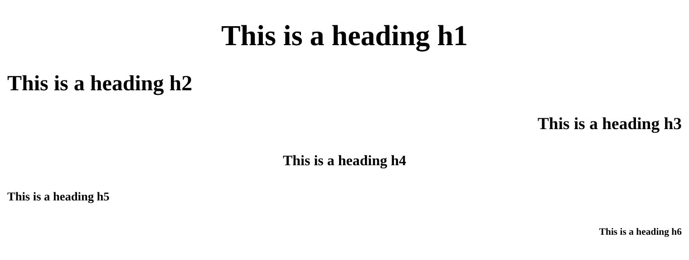

# Bài 1.2.3. Phối hợp các loại canh lề

Bài tập trong giáo trình *Bài tập Thiết kế Web*, phần 1.2 Định dạng văn bản (trang 20, hình 1.6).

## Đề bài

Phối hợp sử dụng các thẻ Hn và canh lề. Trong đó canh giữa `align="center"`,
canh phải `align="right"`, canh trái `align="left"` (mặc định).

## Kết quả

Mở tệp **`alignment.html`** bằng trình duyệt.

## Kiến thức sử dụng

| Thẻ / thuộc tính | Tác dụng |
|---|---|
| `<h1>` … `<h6>` | 6 cấp tiêu đề, h1 lớn nhất, h6 nhỏ nhất |
| `align="center"` | canh giữa (h1, h4) |
| `align="left"` | canh trái (h2); h5 không ghi `align` nên canh trái theo mặc định |
| `align="right"` | canh phải (h3, h6) |
| `<!-- ... -->` | ghi chú trong mã nguồn, không hiện trên trang |

> Ghi chú thêm: trong HTML5, thuộc tính `align` đã cũ (trình kiểm tra của W3C nhắc
> "obsolete"). Bài này vẫn dùng `align` vì đề yêu cầu. Cách viết hiện nay là dùng CSS,
> ví dụ `<h1 style="text-align: center">`.
